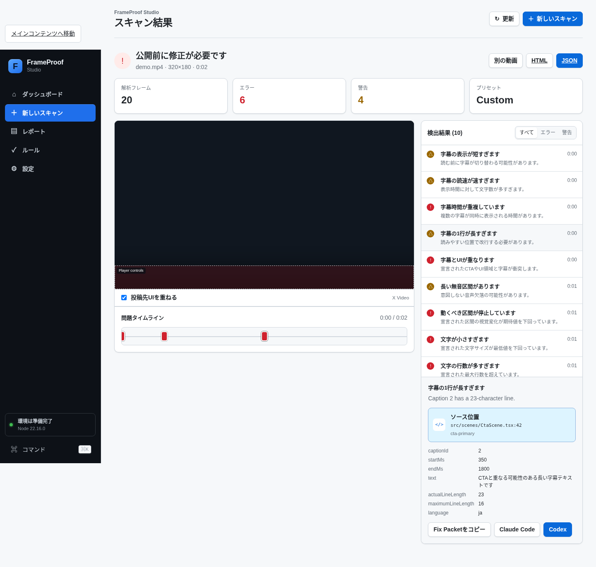

# FrameProof Video QA

[日本語README](README.ja.md)

**Source-aware verification, revision gates, and repair loops for AI-generated and programmatic video.**

FrameProof audits the final rendered video, optional caption sidecars, final-export audio, and an optional Render Manifest that maps frame intervals back to Remotion compositions, sequences, components, and source files. It provides a local Studio, CLI, GitHub Action, and one Agent Skill shared by Claude Code and Codex.

> Status: v0.8.1 release candidate. This security-hardening release rejects stale render artifacts, fails closed on unmapped Agent repairs, protects Studio APIs with per-start authentication, removes shell command interpretation, and adds analysis resource budgets. v0.8 added production preflight and render-health receipts.

## Why FrameProof exists

Code can type-check and a renderer can exit successfully while the final video still contains:

- blank transition frames or unintended visual freezes;
- text declared too small for the destination layout;
- an animation that was expected but never appeared;
- captions that are too fast, too short, overlapping, or colliding with UI;
- a missing audio stream, long unexpected silence, or unsafe loudness;
- the wrong aspect, codec, frame rate, duration, or file size;
- a defect that is visible in the MP4 but difficult to trace back to source.

FrameProof converts those failures into deterministic findings and **Fix Packets** containing source location, expected and actual values, suggested actions, and reproduce/verify commands.

## Positioning

FrameProof does not try to replace broadcast QC suites, NLEs, or reference-quality metrics such as VMAF. Its primary question is:

> Did this code- or agent-generated render satisfy the declared creative and technical intent, and can a human or coding agent locate and verify the smallest repair?

The core scanner remains renderer-agnostic. Render Manifests add source awareness without requiring React or Remotion at runtime.

## Requirements

- Node.js 20 or newer;
- FFmpeg and FFprobe on `PATH`.

There are no npm runtime dependencies. Video and report data remain on the local machine.

## Three-command project workflow

```bash
npx frameproof-video-qa doctor
npx frameproof-video-qa init --video out/video.mp4
npx frameproof-video-qa verify
```

`init` detects Remotion when present and writes a non-destructive `.frameproof/project.json`, recommended config, acceptance file, and a disabled manifest example. `verify` writes JSON, HTML, Fix Packets, SARIF, JUnit, and a machine-readable verification summary to `.frameproof/artifacts/latest`.

After reviewing the completed video and report, promote the reviewed state as the revision baseline:

```bash
npx frameproof-video-qa baseline set .frameproof/artifacts/latest/report.json
npx frameproof-video-qa baseline status
```

See [Project onboarding](docs/ONBOARDING.md) and [Environment diagnostics](docs/DOCTOR.md).

## FrameProof Studio


```bash
npx frameproof-video-qa studio
```

On Windows, extract the source ZIP and double-click `START_STUDIO.cmd`.

Studio provides:

- drag-and-drop, file picker, and local-path video selection;
- Recommended, Fast, Strict, and custom modes;
- optional Render Manifest and SRT/WebVTT/JSON caption inputs;
- frame, caption, audio, source-aware assertion, and platform checks;
- platform UI preview overlays for TikTok, Reels, Shorts, and X;
- issue timeline, source panel, and one-click Fix Packet copying;
- repair prompts for both Claude Code and Codex;
- local report history and JSON/HTML exports;
- baseline comparison with new, regressed, improved, resolved, unchanged, and accepted statuses;
- one-click accepted-finding persistence for future revisions.

Platform overlays are documented preview approximations, not pixel-perfect guarantees for every device or app version.



## File-only scan

```bash
npx frameproof-video-qa scan video.mp4 \
  --aspect 16:9 \
  --json artifacts/frameproof.json \
  --html artifacts/frameproof.html
```

## Source-aware scan

```bash
npx frameproof-video-qa manifest validate .frameproof/manifest.json

npx frameproof-video-qa scan out/video.mp4 \
  --manifest .frameproof/manifest.json \
  --captions out/captions.srt \
  --audio --check-silence \
  --json artifacts/frameproof.json \
  --html artifacts/frameproof.html \
  --fix-packets artifacts/fix-packets.json
```

See [Remotion source-aware integration](docs/REMOTION_INTEGRATION.md) and the [manifest JSON schema](docs/frameproof-manifest.schema.json).

## Revision gate

```bash
npx frameproof-video-qa scan out/current.mp4 \
  --manifest .frameproof/manifest.json \
  --baseline .frameproof/baseline.json \
  --acceptances .frameproof/acceptances.json \
  --json artifacts/current.json \
  --revision-json artifacts/revision.json \
  --revision-html artifacts/revision.html \
  --markdown artifacts/frameproof-pr.md \
  --sarif artifacts/frameproof.sarif \
  --junit artifacts/frameproof.xml
```

With a baseline, CI fails only for new or regressed error-level findings. Existing unchanged findings remain visible but do not block the revision gate. Reviewed exceptions can be stored in `.frameproof/acceptances.json`.

Generate a side-by-side changed-frame filmstrip from existing reports:

```bash
npx frameproof-video-qa compare artifacts/current.json \
  --baseline .frameproof/baseline.json \
  --filmstrip-dir artifacts/filmstrip \
  --html artifacts/revision.html
```

See [Revision workflow](docs/REVISION_WORKFLOW.md) and [CI outputs](docs/CI_OUTPUTS.md).

## Render Manifest and assertions

```ts
import {createManifestBuilder, saveManifest} from 'frameproof-video-qa';

const manifest = createManifestBuilder({
  compositionId: 'ProductLaunch',
  fps: 30,
  durationInFrames: 900,
  width: 1080,
  height: 1920
})
  .region({
    id: 'cta-primary',
    role: 'cta',
    from: 720,
    to: 899,
    source: {file: 'src/scenes/CtaScene.tsx', line: 42},
    box: {x: 0.1, y: 0.78, width: 0.8, height: 0.14},
    style: {fontSizePx: 44, lineCount: 2}
  })
  .expectMotion({id: 'cta-entry', from: 720, to: 750, regionId: 'cta-primary', expected: {minimumChange: 0.08}})
  .expectText({id: 'cta-copy', from: 720, to: 899, regionId: 'cta-primary', expected: {minimumPx: 42, maximumLines: 2}})
  .expectSafeArea({id: 'cta-safe', from: 720, to: 899, regionId: 'cta-primary', expected: {platform: 'youtube-shorts'}})
  .build();

await saveManifest('.frameproof/manifest.json', manifest);
```

Available assertion kinds:

- `motion`: expected visual change in a frame interval;
- `text`: declared font size and line count;
- `visible`: expected non-flat visible content;
- `audio`: expected audio with a maximum permitted silence interval;
- `safe-area`: normalized element box against margin and platform UI zones.

## Caption and audio checks

Caption adapters support SRT, WebVTT, Remotion-style caption arrays, and JSON word/segment timing. Checks include duration, characters per second, line count, language-aware line length, overlap/gaps, video-duration overflow, and collision with declared UI regions.

Audio checks operate on the final export and include audio-stream presence, silence intervals, integrated loudness, and true peak. Audio analysis is opt-in with `--audio`; use `--check-silence` to report generic long-silence warnings. `ExpectAudio` assertions run when present in a manifest.

## GitHub Action

```yaml
- name: Audit rendered video
  uses: yocchi12345jp/frameproof-video-qa@v0.8.1
  with:
    video: out/video.mp4
    manifest: .frameproof/manifest.json
    captions: out/captions.srt
    audio: true
    preset: x-video
    json-report: artifacts/frameproof.json
    html-report: artifacts/frameproof.html
    fix-packets: artifacts/fix-packets.json
    baseline-report: .frameproof/baseline.json
    acceptances: .frameproof/acceptances.json
```

## Claude Code and Codex

```bash
npx skills add yocchi12345jp/frameproof-video-qa \
  --skill generated-video-auditor \
  --agent claude-code \
  --agent codex
```

The canonical workflow is [`skills/generated-video-auditor/SKILL.md`](skills/generated-video-auditor/SKILL.md). `CLAUDE.md` and `AGENTS.md` contain repository-specific instructions, while the same Fix Packet format is consumed by both agents.

## Current checks

| Layer | Checks |
|---|---|
| Render frames | Blank frames, frozen runs, edge activity, aspect ratio |
| Platform metadata | Resolution, aspect family, container, codec, pixel format, FPS, duration, file size |
| Captions | Duration, reading speed, lines, line length, gaps, overlap, timeline overflow, UI collision |
| Audio | Stream presence, silence intervals, integrated loudness, true peak |
| Manifest assertions | Motion, text metadata, visibility, audio expectation, safe area |
| Repair context | Source mapping, expected/actual values, Fix Packets, reproduce and verify commands |
| Revision gate | New, regressed, improved, unchanged, resolved, accepted; Markdown, SARIF, JUnit, filmstrips |
| Project workflow | Environment diagnosis, non-destructive init, stable verify bundle, reviewed-baseline receipt |

## Exit codes

- `0`: no error-level findings, or no new/regressed errors when a baseline is supplied;
- `1`: current errors without a baseline; with a baseline, new/regressed errors; warnings also fail with `--fail-on-warning`;
- `2`: invalid input, configuration, manifest, or environment.

## Documentation

- [Project onboarding](docs/ONBOARDING.md)
- [Environment diagnostics](docs/DOCTOR.md)
- [Revision workflow](docs/REVISION_WORKFLOW.md)
- [CI outputs](docs/CI_OUTPUTS.md)
- [Remotion integration](docs/REMOTION_INTEGRATION.md)
- [Manifest schema](docs/frameproof-manifest.schema.json)
- [Studio](docs/STUDIO.md)
- [Architecture](docs/ARCHITECTURE.md)
- [Competitive and creator-pain research](docs/COMPETITIVE_AND_CREATOR_PAIN_RESEARCH_2026-08.md)
- [Roadmap](ROADMAP.md)
- [Claude Code and Codex compatibility](docs/AGENT_COMPATIBILITY.md)
- [Security](SECURITY.md)

## License

MIT. See [LICENSE](LICENSE).
